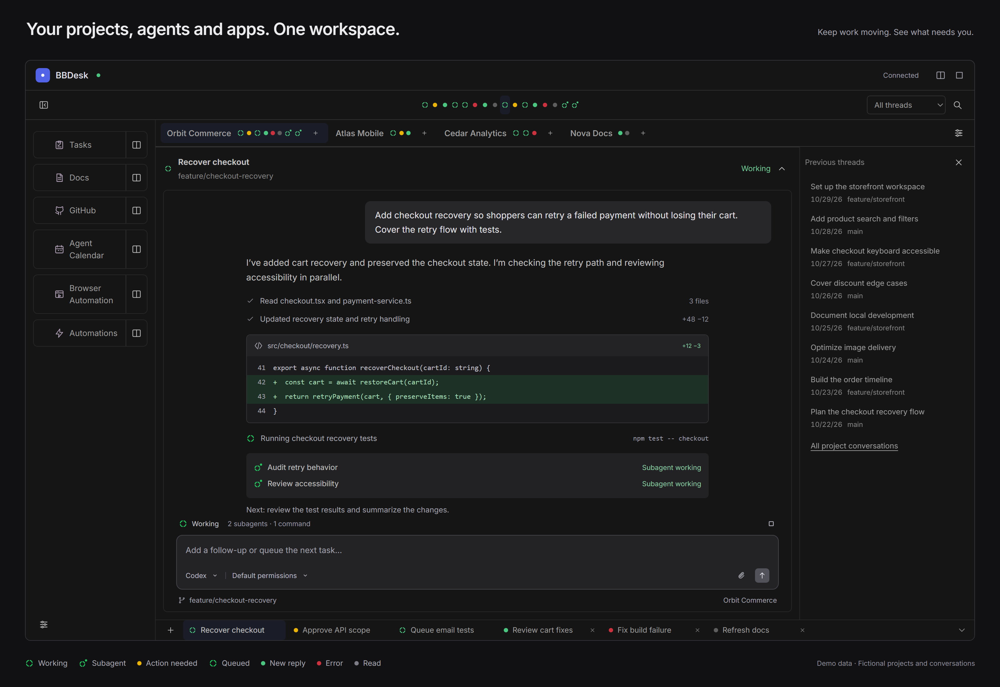

# BBDesk

Your BB projects, chats and applications in one workspace.

BBDesk combines an application launcher, project tabs and live activity indicators. Embedded chat and new-thread creation use BB's native components.

## What's new in 0.1.8

- **Alphabetical Catalog:** Projects and applications in Catalog settings are sorted by their displayed names using the interface language, ignoring letter case. Search results use the same order. The saved order in workspace panels is preserved.
- **Completion acknowledgement:** A selected conversation keeps a green completion check and time until you leave it. Background results stay green until selected and left, including in split layouts and Shared pool. Starting another run restores work status. Completion acknowledgement and observed times are local to the mounted workspace; timestamps remain in tooltips after acknowledgement.

## Highlights from 0.1.7

- **Searchable Catalog:** Connect projects and applications from two tabs with immediate checkbox changes. Open it from the small settings button in the top toolbar; reorder connected entries in their own panels.
- **Immediate hiding:** Conversation tabs disappear as soon as hiding succeeds, including in More. Background completion preserves the current conversation; failures leave the tab available.
- **Safer pool creation:** A full Shared pool preserves the draft without creating a thread. If it fills during creation, use Open to reach the result. Late results respect newer navigation, unpinning and composer cancellation.
- **Responsive activity refresh:** Show confirmed activity promptly while refresh runs in the background. Saved settings remain confirmed even if a later activity refresh fails.
- **Mobile typing:** Fit chat to the visible viewport while the keyboard is open and temporarily hide workspace navigation without remounting the native chat.
- **Maintenance:** Simplify workspace state and views, remove unused UI dependencies and split automated tests into independent groups. Existing settings and storage formats are retained.

Pool conversations from disconnected projects remain listed as unavailable until removed. Archived threads, threads hidden in BB and subagents are excluded.

The pool holds up to 50 conversations, including unavailable saved entries. When it is full, submitting from its composer keeps the draft and does not create a thread. If the pool fills while creation is already in progress, the created conversation remains accessible through an **Open** action in the current workspace. This recovery control is temporary and is not saved across reloads; the thread itself remains in BB. A late result preserves newer navigation and respects explicit unpinning. Turning the pool off cancels its composer without deleting saved entries or allowing a late result to reopen the pool. Disconnecting a composing project also prevents a late result from taking over navigation.

Drag a bottom thread tab or a conversation from the history panel into the workspace to open it alongside the current chat. Drop on the left or right half of a column to insert there. Drag the dividers to resize adjacent chats; arrow keys also resize and double-click equalizes widths. Click a column to activate it: bottom tabs replace only that column, or focus a chat already open beside it. Alt+Enter on a bottom tab and the history panel's Open alongside button provide keyboard alternatives. Close a column with its header X; this does not hide, archive or stop the thread. Layouts are remembered locally per project. Columns have a minimum width of 320px and scroll horizontally when necessary.



[What the preview shows](docs/SHOWCASE.md).

## Features

- Use the Projects and Applications tabs in Catalog to connect or disconnect entries with a checkbox. Connected entries are green; changes apply immediately.
- Identify each project's agent providers through icons beside its name, with provider and conversation details in tooltips.
- Read and continue threads directly in the workspace.
- Work with multiple conversations in resizable columns; layouts, active columns and widths are remembered in this browser per project.
- Browse bottom conversation tabs from newest to oldest by creation time; status changes keep their order stable.
- Open local file links from embedded chat in BB's native file preview on the conversation's host, including line locations.
- Return to the last conversation in each project, including history, after switching projects or reloading the same browser tab.
- Browse recent conversations with two-line titles, dates and environments, or open the full project in BB. On narrow workspaces history overlays the chat; project tabs stay in a single scrolling row.
- Hidden tabs disappear as soon as hiding succeeds, without a timed placeholder. Hiding the current conversation selects a neighboring tab; hiding a background conversation keeps the current chat open.
- Start a thread with its project preselected in BB's native composer.
- Change permission mode before the next prompt in an existing thread. New threads start with the last mode successfully used in BBDesk, remembered in this browser; BB still enforces provider and machine limits.
- Open registered application screens here or alongside using BB's native split action.
- Collapse and resize the application panel; its layout is remembered in your browser.
- Follow delegated agents through activity indicators without retaining completed subagent rows.

Connecting a project imports current work, queued work and pending questions. Earlier completed replies are not imported. New results remain until hidden. Hiding never archives or deletes a thread; fresh activity brings it back.

Settings and history close on Escape and return keyboard focus to their opener. Thread search and the All threads/attention filter have been removed; the toolbar contains the application toggle and activity indicators. Project-conversation memory belongs to the current browser-tab session and does not change shared project settings. Native drafts and existing reading-position handling remain owned by their existing mechanisms.

## Unified catalog

One small settings button on the right of the top toolbar opens Catalog. It has two tabs, **Projects** and **Applications**, with a searchable compact list in each. Connected entries are green with a checked checkbox. Click the checkbox or its label to connect or disconnect immediately, without opening an entry or closing settings.

There are no duplicate selected lists, reorder controls, application opening actions, label editors or Undo controls in settings. Reorder projects and applications directly in their panels. **Done** closes Catalog; there is no separate save step. Common threads and Shared pool remain checkboxes in the Projects tab.

Unavailable saved entries appear in the same list and can be disconnected. Opening settings, searching and switching tabs preserve the mounted native chat and its draft.

## Requirements

- BB `>=0.48` with Plugin SDK `>=0.6.94 <0.7.0`.
- For local development: Node.js 24.22.1 and npm 11 (the verified environment), with `bb` on PATH.
- Internet access to download dependencies and build tools on first installation.

The plugin uses experimental BB APIs. The declared compatibility range does not mean that every version in that range has been tested. No external services or API keys are required.

## Install from GitHub

```sh
bb plugin install https://github.com/devalextelematika/BBDesk
```

Review the source proposed by BB and confirm installation.

## Install from local source

Open a terminal in the plugin directory, next to `package.json`:

```sh
npm ci --include=dev
npm run typecheck
npm test
npm run build
bb plugin install .
```

BB must be running for installation. It builds local plugins again during installation. Keep the source directory in a permanent location after installing from a local path.

## Get started

Open **BBDesk** in BB navigation, then use the small **Configure projects and applications** settings button on the right of the top toolbar to connect projects and add application shortcuts. The stable plugin ID is `dashboard`; the page is `/plugins/dashboard/home` on your BB server.

If the launcher asks you to enable its navigation provider, choose **BBDesk** under **Settings → Appearance → Navigation**. It preserves BB's original rail and supplies the registered screens and native actions. Settings-only plugins do not provide launchable screens.

Selected projects, their order, Shared pool visibility and application shortcuts are stored on the BB server and shared by its clients. The application panel's width and open state, per-project split layouts and the shared pool's conversations and layout are stored separately in each browser.

## Interface language

Open BB's settings for installed plugins, select **BBDesk**, and change **Interface language**:

- **English** is the default for new and existing installations without a saved preference.
- **Русский** enables the Russian interface.

The choice is stored by BB and shared across clients of the same BB server. No automatic language detection is used. Switching language updates BBDesk labels without resetting the selected project, open chat or settings.

Project names, thread content, user-defined shortcut names and other applications keep their original text. BB's native chat and composer manage their own labels. The language selector itself uses the stable labels English and Русский.

## Development

```sh
npm run typecheck
npm test
npm run build
```

Tests use Node's test runner, the SDK fake host and the SDK DOM harness. They check activity rules, language settings, translation coverage and UI behavior. These checks do not replace testing an installed plugin in BB. CI runs type checking and tests; building requires the BB CLI.

`npm test` discovers root unit tests and the files under `tests/`, preloads the TypeScript/TSX loader, and runs files sequentially in separate Node processes. UI groups cover catalog/navigation, conversation memory, hiding/overflow, creation/late replies, split/shared pool, viewport/reading/files, snapshot refresh races, workspace transitions and mounted view lifecycles. Backend groups cover configuration/contracts and synchronization/lifecycle; permission-memory unit tests remain at the root. Pure workspace selectors, transition rules and view models have separate unit tests. Shared helpers own DOM, SDK slots, storage cleanup, factories, deferred responses and interaction fixtures. Each UI test releases its navigation bridge and React trees before restoring browser overrides, including when its callback throws. Backend tests use the SDK's real temporary SQLite storage.

Run a group independently by passing its file to the same runner:

```sh
npm test -- tests/ui/creation.test.mjs
npm test -- tests/backend/synchronization-lifecycle.test.mjs
```

Keep test files independent of module cache and execution order. Avoid restoring a production singleton through test-only exports; dispose its owning UI or harness instead. New TypeScript modules under `tests/` are included in type checking.

Zod is the only production npm dependency. BB supplies React and the public SDK runtime to the built frontend. Development dependencies include the pinned SDK and its backend harness peers (`better-sqlite3`, `cron-parser`, `hono` and their required types), React/React DOM with Testing Library and jsdom for UI tests, TypeScript, and `css-tree` for CSS checks. Keep these test dependencies explicit even when the application does not import them directly.

The lockfile pins the tested dependency tree; the SDK declaration/harness pin is `0.6.94`. The BB CLI builds with its own SDK and can warn when that differs from the package pin. Record both versions when verifying a release. A successful build with one host SDK does not validate the entire declared compatibility range; repinning the SDK is a separate change. Use a separate clean production-dependency copy to check the Git-install build policy described in [publishing notes](docs/PUBLISHING.md).

Activity snapshots return the last confirmed state without waiting for SDK history reads. An initial snapshot can have `syncedAt: null`; background reconciliation publishes updates through `dashboard-changed`. Configuration mutations acknowledge durable settings writes and schedule activity import separately, so a later synchronization failure does not mean that saving settings failed.

The activity service performs periodic full passes and coalesces targeted updates. Only a successful complete full pass advances `syncedAt` and clears `syncError`; cached snapshots and targeted passes do neither. Successful passes are spaced by at least 750 ms when more work is queued; failed reads or tracking writes retry after 5 seconds. Hide/restore and project connection revisions protect newer actions from older read results. Abort/disposal requests SDK cancellation through `AbortSignal`, invalidates pending results and prevents new background writes. An adapter may still finish an SDK call after cancellation, and a storage write already started cannot be rolled back by cancellation.

After local installation, `bb plugin dev` rebuilds and reloads the plugin when files change.

Key files:

- `server.ts`: RPC, native plugin settings and activity tracking.
- `contracts.ts`: shared configuration, catalog and RPC schemas/types.
- `configuration.ts`, `catalog-config.ts`: atomic configuration transformations and compatibility adapters.
- `activity-sync.ts`: coalesced background reads, retry timing and cancellation.
- `state.ts`: thread inclusion and hiding rules, with explicit sidebar/server activity adapters.
- `hooks/use-dashboard-snapshot.ts`: coalesced snapshot reads, realtime/reconnect refresh, and configuration revision guards.
- `workspace-selectors.ts`: per-render thread/project/tracking indices, visibility, status, entry selection, history and project/pool models. Indices are rebuilt from current inputs so in-place updates cannot leave a persistent cache stale.
- `workspace-transitions.ts`: pure workspace events and explicit conversation/composer selection, with pending operations kept separately.
- `hooks/use-workspace.ts`, `hooks/use-workspace-actions.ts`: synchronous transition dispatch, compatible browser persistence, and SDK/RPC effects. See [workspace transitions](docs/WORKSPACE_TRANSITIONS.md) for the event table and race guards.
- `app.tsx`: workspace coordination, navigation and view-model wiring.
- `workspace-view-models.ts`: project/pool presentation data, including cached titles, details and status within one render.
- `components/project-workspace.tsx`, `components/shared-pool-workspace.tsx`: separate project/pool views with typed data and domain actions.
- `components/workspace-chat.tsx`: native chat wrapper, file surface, permission memory and reading lifecycle shared by both views.
- `split-layout.ts`, `split-workspace.tsx`: conversation columns, resizing and local layout persistence.
- `launcher-navigation.tsx`: bridge to BB navigation.
- `launcher-panel.tsx`: application panel layout and persistence.
- `i18n.ts`, `locales/`, `use-translation.ts`: translation catalogs and language selection.
- `styles.css`, `components/`, `assets/`: styling and resources.

Keep the package name `bb-plugin-dashboard`: the `dashboard` ID, routes and stored settings depend on it. Adding another language requires a translated catalog and an explicit setting option; there is no user-facing translation editor.

Existing RPC methods and whole-list replacement behavior remain available. See [RPC compatibility](docs/RPC_COMPATIBILITY.md) for the caller inventory, catalog operations and preserved semantics.

Dependencies, generated `dist/`, archives and local verification reports are excluded from Git. See [publishing notes](docs/PUBLISHING.md) for release checks and authorization boundaries.

Version `0.1.8` is a patch update from `0.1.7`. See the [changelog](CHANGELOG.md) and [v0.1.8 release notes](docs/releases/v0.1.8.md) for changes, verification and remaining acceptance checks. Install this exact release with `bb plugin install git:https://github.com/devalextelematika/BBDesk.git@v0.1.8`. Installing from the default GitHub URL follows the published default branch. Existing release tags must not be moved.

## License

[MIT](LICENSE). Copyright (c) 2026 devalextelematika. See [THIRD_PARTY_NOTICES.md](THIRD_PARTY_NOTICES.md) for vendored UI notices. Installed npm dependencies retain their own licenses.
