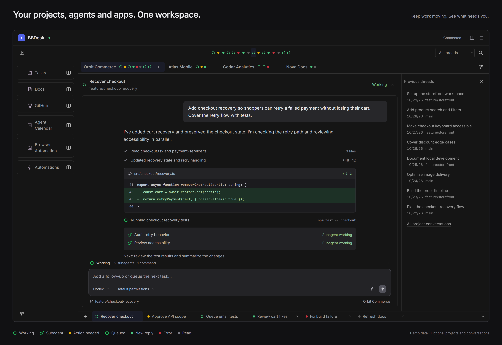

# BBDesk interface preview

The overview image uses fictional English data. It demonstrates the current BBDesk workspace layout, with an illustrative conversation in the area normally rendered by BB's native chat. It is a staged preview, not a recording of an actual agent run.

- Four projects: Orbit Commerce, Atlas Mobile, Cedar Analytics and Nova Docs.
- Application shortcuts, each with an action to open the application alongside the workspace.
- Activity indicators across all selected projects and within each project tab, including active subagents.
- An active checkout task with an illustrative code change, a running test command, two subagents and a follow-up composer.
- Six independent conversations showing Working, Action needed, Queued, New reply, Error and Read states.
- Previous conversations with dates and environments, plus the link to all project conversations.
- Search, the attention filter, project selection, application configuration and new-thread controls.

The legend and headline are presentation elements outside the plugin window. All project names, task titles, branches, code and conversation text are fictional. No real projects, threads, credentials or personal data were used in the image. The preview does not create projects, launch agents or change BB settings.

`images/bbdesk-overview.png` is a 3200 × 2200 PNG, captured from a 1600 × 1100 browser layout at 2× scale. BBDesk's actual React components and stylesheet provide the plugin layout. The local rendering fixture, browser profiles and verification output are excluded from the repository.
